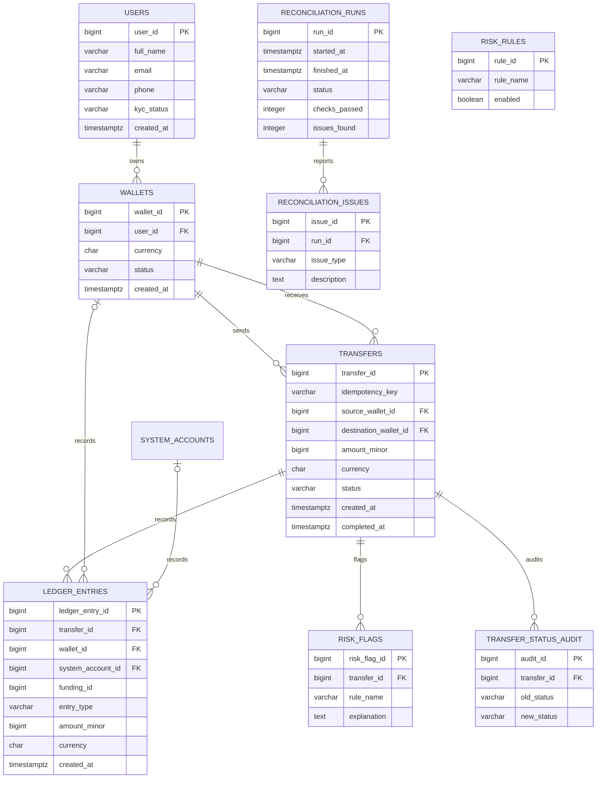

# Database Schema Design

## 1. Introduction

This project uses PostgreSQL to store users, wallets, money transfers, and ledger entries.

The database currently has 11 main tables:

- `users`
- `wallets`
- `system_accounts`
- `transfers`
- `ledger_entries`
- `wallet_fundings`
- `reconciliation_runs`
- `reconciliation_issues`
- `risk_rules`
- `risk_flags`
- `transfer_status_audit`

The database also has a `wallet_balances` view, which calculates wallet balances from ledger entries.

Primary keys and foreign keys connect related records. Database constraints, SQL functions, and application tests provide additional protection for money transfers.

## 2. Tables and Their Purpose

| Table | Purpose |
|---|---|
| `users` | Stores user details, email, phone, and KYC status. |
| `wallets` | Stores wallets owned by users and their currencies and statuses. |
| `system_accounts` | Stores internal payment-system accounts. |
| `transfers` | Stores transfer amounts, source and destination wallets, status, and timestamps. |
| `ledger_entries` | Stores debit and credit entries for money movements. |
| `wallet_fundings` | Records wallet-funding operations. |
| `reconciliation_runs` | Stores the results and status of reconciliation runs. |
| `reconciliation_issues` | Stores problems detected during reconciliation. |
| `risk_rules` | Stores configurable risk rules and their thresholds. |
| `risk_flags` | Stores transfers flagged for risk and their review details. |
| `transfer_status_audit` | Records changes to transfer status. |

## 3. Main Tables and Attributes

### 3.1 Users

The `users` table stores information about each user.

- `user_id`: Primary key.
- `full_name`: User's full name.
- `email`: Email address.
- `phone`: Phone number.
- `kyc_status`: Know Your Customer verification status.
- `created_at`: Date and time when the user was created.

### 3.2 Wallets

The `wallets` table stores user-owned wallets.

- `wallet_id`: Primary key.
- `user_id`: Foreign key referencing `users`.
- `currency`: Wallet currency, currently INR.
- `status`: Wallet status.
- `created_at`: Wallet creation time.

A user can own multiple wallets. The database constraints determine which wallet combinations are allowed.

### 3.3 System Accounts

The `system_accounts` table stores internal accounts used by the payment system.

- `system_account_id`: Primary key.
- `account_name`: Account name.
- `account_type`: Type of system account.
- `currency`: Account currency.
- `created_at`: Account creation time.

Examples include clearing and fee accounts.

### 3.4 Transfers

The `transfers` table stores money-transfer details.

- `transfer_id`: Primary key.
- `idempotency_key`: Key used to identify repeated requests.
- `source_wallet_id`: Wallet sending the money.
- `destination_wallet_id`: Wallet receiving the money.
- `amount_minor`: Amount stored as a whole number of minor currency units.
- `currency`: Transfer currency.
- `status`: Current transfer status.
- `created_at`: Transfer creation time.
- `completed_at`: Completion time, when applicable.

The application validates transfer amounts and prevents a wallet from spending more money than it has. Idempotency handling is tested so that retries do not create duplicate transfers and reuse of a key with a different request body is rejected.

The exact database constraints and application logic should be reviewed together when evaluating idempotency guarantees.

### 3.5 Ledger Entries

The `ledger_entries` table records money movements.

- `ledger_entry_id`: Primary key.
- `transfer_id`: Reference to the related transfer.
- `wallet_id`: Wallet involved, when applicable.
- `system_account_id`: System account involved, when applicable.
- `entry_type`: Debit or credit.
- `amount_minor`: Entry amount in minor currency units.
- `currency`: Entry currency.
- `created_at`: Entry creation time.
- `funding_id`: Related funding record, when applicable.

Ledger entries provide the accounting record behind wallet balances. Money movements should have matching debit and credit amounts.

Completed transfers should be corrected through reversal entries or transfers rather than by silently changing historical accounting records. Database-level immutability and balancing constraints must be verified separately.

### 3.6 Wallet Funding

The `wallet_fundings` table records wallet-funding operations. Funding operations use the funding logic defined by the project migrations.

### 3.7 Reconciliation

The `reconciliation_runs` table records each reconciliation run, including its start and finish times, status, checks passed, and issues found.

The `reconciliation_issues` table stores detected problems and can link an issue to a transfer or wallet.

The worker runs reconciliation and records the result. A verified run in the current environment completed with four checks passed and zero issues found. This result describes that run only; it does not prove that every corruption scenario has been tested.

### 3.8 Risk Rules and Flags

The `risk_rules` table stores risk-rule configuration, including whether a rule is enabled and its thresholds.

The `risk_flags` table records transfers flagged for review. It includes the rule name, details, review information, resolution, and explanation.

The existence of these tables does not by itself prove that every required fraud scenario or automated explanation workflow is complete.

### 3.9 Transfer Status Audit

The `transfer_status_audit` table records transfer status changes, including the old status, new status, actor, and time of change.

## 4. Relationships and Cardinality

| Relationship | Cardinality | Explanation |
|---|---|---|
| Users to wallets | One-to-many | A user may own multiple wallets. |
| Wallets to outgoing transfers | One-to-many | A wallet may send multiple transfers. |
| Wallets to incoming transfers | One-to-many | A wallet may receive multiple transfers. |
| Transfers to ledger entries | One-to-many | A transfer may have multiple accounting entries. |
| Wallets to ledger entries | One-to-many | A wallet may have multiple ledger entries. |
| System accounts to ledger entries | One-to-many | A system account may have multiple ledger entries. |
| Reconciliation runs to issues | One-to-many | A run may identify multiple issues. |
| Risk rules to risk flags | Logical relationship | A rule name identifies the rule associated with a flag. |

Foreign keys connect related records where defined by the schema. The precise constraints can be checked in the database migrations.

## 5. ER Diagram

This diagram shows the main relationships. Consult the migrations for the complete set of columns, indexes, and constraints.

## 6. Design Decisions

### How is money stored?

Money is stored as an integer number of minor currency units. For INR, one rupee equals 100 paise.

For example, ₹250.00 is stored as `25000`. Integer storage avoids floating-point rounding errors.

### How are wallet balances calculated?

The `wallet_balances` view calculates balances from ledger entries. This reduces the need to maintain a separate balance that could become inconsistent.

The trade-off is that calculating balances can become slower as the ledger grows. If a stored balance is introduced or maintained, every money movement must update it safely and reconciliation must verify it against the ledger.

### Why are wallet and system accounts separate?

Wallets belong to users, while system accounts support internal payment operations. Keeping them separate makes their purposes clear but requires ledger logic to handle both account types.

### Why use generated IDs?

Generated IDs provide stable references between tables. Email addresses and phone numbers may change, so they are not ideal primary keys.

### Why is the ledger important?

The ledger records both sides of money movements. Debit and credit totals should balance.

Historical ledger records should be protected from modification or deletion. Corrections should use reversal records so that the accounting history remains understandable.

## 7. Indexes and Performance

The project migrations create indexes for important wallet, transfer, and ledger queries. Indexes can speed up searches and pagination, but they use storage and add work to inserts.

Query plans should be checked with `EXPLAIN ANALYZE` using representative data. Performance at one million ledger entries still needs to be demonstrated if required by the assignment.

## 8. Remaining Verification

The database now includes user phone and KYC fields, reconciliation tables, risk tables, and transfer-status auditing. The following requirements still need explicit verification or completion:

- Confirm transfer types, including top-up, peer transfer, withdrawal, fee, and reversal.
- Verify idempotency storage and replay behavior against all required cases.
- Verify that ledger entries cannot be edited or deleted and that all relevant transfers balance.
- Run the four required transaction-isolation experiments and document actual outputs.
- Run the concurrent-transfer acceptance test repeatedly.
- Test reconciliation against deliberate corruption and large datasets.
- Verify fraud rules, hold behavior, risk explanations, and their performance cost.
- Add or verify the required large seed-data script and performance tests.
- Ensure the README explains setup, design choices, trade-offs, and remaining limitations.

The schema and migration files should be checked together before claiming that every assignment requirement is complete.
